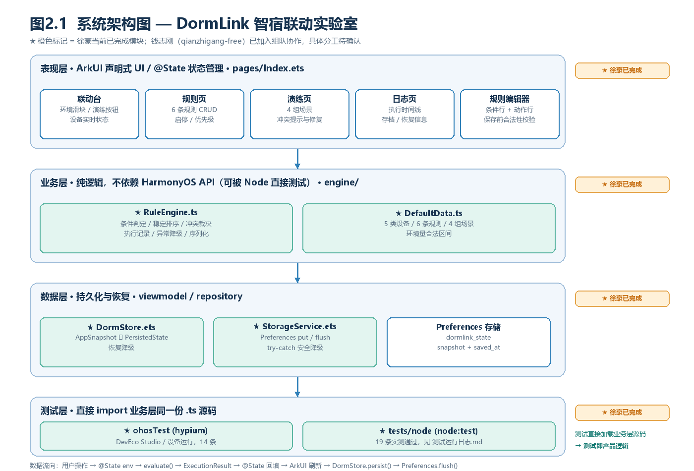

# DormLink 智宿联动实验室

> 《鸿蒙高级应用开发工程师认证》期末大作业 · 主题三「联动实验室：智能宿舍自动化规则编排 App」
>
> **作者**：徐豪（20230313120，23物联1）　**GitHub 账号**：`sober-free`
> **仓库**：https://github.com/sober-free/dormlink-harmony



> 上图为系统架构示意图（由本仓库脚本绘制，非运行截图）。应用运行截图与录屏见第 7 节说明。

---

## 1. 作品简介

宿舍里的灯、空调、窗帘、风扇、加湿器通常各按各的开关，缺少"满足条件就自动联动"的统一编排。DormLink 把这件事做成一个**完全本地、可模拟、可持久化**的 HarmonyOS 应用：用户用 Mock 环境数据（温度、光照、湿度、时段、在室状态）驱动规则引擎，自定义"当…则…"规则，观察设备如何联动、日志如何记录、冲突如何裁决，并在修改规则后立刻复验。

核心体验链路：**新建/修改规则 → 调整 Mock 环境 → 观察设备联动及日志 → 载入冲突场景并调整规则 → 结束进程重启恢复方案**。

不依赖真实硬件、网络或云平台；所有业务判断由本地纯逻辑规则引擎完成。

## 2. 功能清单

| 需求 | 题目要求 | 本作品实现 |
| --- | --- | --- |
| 设备类型 | ≥4 类 | **5 类**：主灯、空调、窗帘、风扇、加湿器 |
| 模拟环境量 | ≥3 项 | **5 项**：温度（-10~50℃）、光照（0~2000lux）、湿度（0~100%）、时段（0~23点）、在室状态 |
| 规则 | ≥4 条，含 1 条双条件规则 | **6 条**默认规则（R001~R006），其中 **R001 / R004 / R006 为双条件**；支持新增、编辑、删除、启停、优先级调整 |
| 规则引擎 | 按实际输入计算，记录触发条件、设备变化、执行顺序 | `evaluate()` 输出设备终态 + `ExecutionRecord`（order / 条件快照 / before→after / 拦截标记）+ `warnings` |
| 冲突处理 | 明确执行顺序或优先级 | 按 `(priority 升序, id 升序)` 稳定排序；同一设备通道仅最高优先级规则写入，其余动作拦截并生成 `ConflictRecord` |
| 场景演练 | ≥2 组 | **4 组**：S1 夏夜归寝、S2 午后无人·冲突、S3 干燥清晨、S4 深夜无人 |
| 持久化 | 设置、规则、执行记录可恢复 | Preferences 单 JSON 快照（`dormlink_state`），保留最近 50 条记录；进程重启自动恢复 |
| 测试 | ≥6 条，覆盖正常/边界/异常 | Node 侧 **19 条全部通过**，DevEco `ohosTest` 侧 14 条 |

### 四个页签

- **联动台**：5 项环境量调节、一键演练、本次结果摘要、5 张设备实时状态卡。
- **规则**：6 条规则卡片（条件/动作/优先级/启停），新增与编辑弹层（最多 3 个条件 + 3 个动作），保存前做合法性校验。
- **演练**：4 组预设场景一键载入并执行；出现冲突时显示胜出/被拦截规则，并提供「一键修复：为高温制冷补充『有人在室』条件」验证冲突消除。
- **日志**：执行时间线（序号、优先级、条件快照、设备变化）、冲突记录、引擎告警、存档时间、清空记录与恢复出厂方案。

## 3. 开发环境

| 项目 | 版本/说明 |
| --- | --- |
| IDE | DevEco Studio 5.0.5 Release（HarmonyOS 5.0.5 / API 17） |
| 语言 / 框架 | ArkTS、ArkUI（声明式 UI）、Stage 模型 |
| SDK | `compatibleSdkVersion: 5.0.5(17)`，`runtimeOS: HarmonyOS` |
| 持久化 | `@kit.ArkData` → `preferences` |
| 测试框架 | `@ohos/hypium`（ohosTest）+ `node:test`（纯逻辑） |
| 纯逻辑测试环境 | Node.js ≥ 22.6（用原生 TypeScript type-stripping 直接执行 `.ts` 源码） |
| 运行载体 | HarmonyOS 模拟器或真机 |

> 若本机 DevEco 的 SDK 版本不同，修改根 `build-profile.json5` 中的 `compatibleSdkVersion` / `targetSdkVersion` 后 Sync 即可。

## 4. 目录结构

```
dormlink-harmony/
├── AppScope/                       应用级配置与图标
├── entry/src/main/
│   ├── ets/entryability/           EntryAbility.ets（窗口与页面加载）
│   ├── ets/pages/Index.ets         ★ 四个页签 UI、@State 状态管理、规则编辑器
│   ├── ets/common/DesignTokens.ets  ★ 设计规范 Token（颜色/字号/间距/圆角/尺寸）
│   ├── ets/engine/RuleEngine.ts    ★ 规则引擎（纯逻辑，不依赖 HarmonyOS API）
│   ├── ets/engine/DefaultData.ts   ★ 默认设备 / 6 条规则 / 4 组场景
│   ├── ets/viewmodel/DormStore.ets ★ 内存态 ↔ 持久化快照、恢复降级
│   ├── ets/repository/StorageService.ets ★ Preferences 读写与异常捕获
│   └── resources/                  页面路由、字符串、颜色、图标
├── entry/src/ohosTest/             ★ DevEco 侧 hypium 单元测试（14 条）
├── tests/node/                     ★ Node 侧测试（19 条，直接加载上面的业务源码）
├── docs/
│   ├── 软件需求说明书.md           ★ 需求、数据模型、接口、分工、测试、验收
│   ├── 测试运行日志.md             ★ 真实命令输出（19/19 通过）
│   ├── 设计规范.md                 ★ Design System：Token、组件、布局、自查清单
│   ├── 运行与录屏指南.md           导入/编译/截图/录屏分镜
│   ├── 系统架构图.png              架构示意图
│   └── 业务流程图.png              规则引擎执行流程图
├── screenshots/                    运行截图与录屏存放目录（由本人实机补录）
└── build-profile.json5 / hvigorfile.ts / oh-package.json5
```

★ 为本人（徐豪 / `sober-free`）独立完成的模块。

## 5. 运行方法

1. 打开 DevEco Studio → `File > Open`，选择本仓库根目录 `dormlink-harmony`。
2. 等待 `Sync` / `ohpm install` 完成；如提示签名，使用 `File > Project Structure > Signing Configs` 开启自动签名。
3. 启动 HarmonyOS 模拟器或连接真机，点击 `Run 'entry'`（▶）。
4. 首次启动加载 6 条默认规则；推荐验收顺序：
   - 联动台拖动温度到 30℃ → 点「执行联动演练」→ 空调变为 ON。
   - 规则页点「+ 新增规则」，配置一个双条件规则并保存 → 立即重新演练。
   - 演练页载入 **S2 午后无人·冲突** → 出现冲突提示（R002 胜出 / R005 被拦截）→ 点「一键修复」→ 冲突数归零。
   - 日志页查看执行序号、条件快照与设备 before→after。
   - **结束应用进程后重新打开** → 日志页显示"已从 Preferences 恢复…"，规则、设备状态与执行记录均保留。
5. 纯逻辑测试（无需 DevEco）：
   ```bash
   node --test tests/node/rule-engine.test.mjs
   ```

## 6. 自动化测试与证据

- `tests/node/rule-engine.test.mjs`：19 条，`node --test` 实测 **19 通过 / 0 失败**，完整 TAP 输出见 [`docs/测试运行日志.md`](docs/测试运行日志.md)。
- `entry/src/ohosTest/ets/test/RuleEngine.test.ets`：14 条 `@ohos/hypium` 用例，在 DevEco Studio 中右键 `ohosTest` → `Run 'Tests in entry'` 执行。
- 测试直接 import `entry/src/main/ets/engine/RuleEngine.ts`，即应用实际运行的那份源码，**没有另写模拟实现**。
- 三类覆盖：正常 7 / 边界 5 / 异常 7（Node 侧），详见需求说明书第 7 节。

## 7. 运行截图与演示视频

在 DevEco Studio 的 **Huawei_Phone 模拟器（HarmonyOS 5.0.5 / API 17）** 上实际编译、安装、运行后采集，全部位于 [`screenshots/`](screenshots/)：

| 文件 | 内容 |
| --- | --- |
| `01-dashboard.jpeg` | 联动台：环境调节、演练结果摘要、设备状态 |
| `02-rule-list.jpeg` | 规则列表：6 条规则，R001 显示双条件 |
| `03-rule-editor.jpeg` | 规则编辑器：条件行 + 动作行 + 优先级 |
| `04-scene-s1.jpeg` | S1 夏夜归寝：触发 R001 → R002 |
| `05-conflict-s2.jpeg` | S2 冲突提示：空调 R002 胜出、R005 被拦截 |
| `06-conflict-fixed.jpeg` | 一键修复后：当前无控制冲突 |
| `07-execution-log.jpeg` | 执行日志：#1~#5，含「已拦截」与设备 before→after |
| `08-restore-after-restart.jpeg` | 结束进程重启后：已恢复存档 + 恢复提示 |
| `09-test-report.jpeg` | 应用内「生成测试报告」：12 条断言全部通过（正常 5 / 边界 3 / 异常 4） |
| `demo-recording.mp4` | 演示视频（18 fps / 124 秒，看规则 → 逐条改数据验证设备 → 异常校验 → 场景冲突 → 日志 → 生成测试报告 → 重启恢复） |

采集方式：`hvigorw.js assembleHap` 编译未签名 HAP → `hdc` 安装启动 → `uitest dumpLayout` + `uiInput` 驱动界面 → `snapshot_display` 截屏，完整命令与执行记录见 [`docs/运行与录屏指南.md`](docs/运行与录屏指南.md)。

**诚实说明**：`demo-recording.mp4` 是模拟器连续截帧后合成的视频——该模拟器镜像不含系统录屏应用，官方录屏链路仅支持真机，故按替代方案产出。`docs/系统架构图.png`、`docs/业务流程图.png` 是设计示意图，不是运行截图。

## 8. 设计规范（Design System）

完整规范见 [`docs/设计规范.md`](docs/设计规范.md)，所有视觉数值的唯一来源是 `entry/src/main/ets/common/DesignTokens.ets`。

| 维度 | 内容 |
| --- | --- |
| 色彩 | 21 个语义 Token：背景 5 层、边框 2 级、文字 4 级、品牌 4 个、状态 6 个 |
| 字体 | 6 级阶梯 19 / 17 / 15 / 13 / 12 / 11，字重仅 Regular 与 Medium |
| 间距 | 4px 基准：4 / 8 / 12 / 16 / 20 / 28 |
| 圆角 | 6 / 10 / 14 / pill |
| 组件 | 按钮 4 类、卡片、状态标签、滑块、开关、输入框、Toast 的尺寸与状态规范 |
| 布局 | 页面边距 16、卡片间距 12、卡片内边距 16、滚动底部留白 80 |

落地效果：`Index.ets` 中**硬编码颜色 0 处、硬编码字号 0 处**，全部替换为 Token 引用（Color 133 / Font 82 / Space 38 / Radius 15 处）。自查命令：

```bash
grep -nE "'#[0-9A-Fa-f]{6}'" entry/src/main/ets/pages/Index.ets   # 应无输出
grep -nE "\.fontSize\([0-9]+\)" entry/src/main/ets/pages/Index.ets # 应无输出
```

## 9. 持久化与异常处理

- 存储：`preferences.getPreferences(context, 'dormlink_state')`，键 `snapshot`（完整 JSON）与 `saved_at`；每次变更 `put → flush` 立即落盘。
- 恢复：`Index.aboutToAppear()` 异步调用 `DormStore.restore()`；存储不可用、无存档、JSON 损坏或字段缺失时安全回退默认方案，并在界面显示原因。
- 引擎侧：越界数值裁剪、NaN/非法规则校验、未知设备忽略、null 输入降级，全部写入 `warnings` 展示在日志页。

## 10. 交付信息

| 项目 | 内容 |
| --- | --- |
| GitHub 仓库 | https://github.com/sober-free/dormlink-harmony |
| 本人 GitHub 账号 | `sober-free` |
| 需求说明书 | `docs/软件需求说明书.md` |
| 测试证据 | `docs/测试运行日志.md` |
| 个人报告 | `鸿蒙高级应用开发工程师认证-20230313120-徐豪-期末大作业报告.docx`（仓库外提交） |
